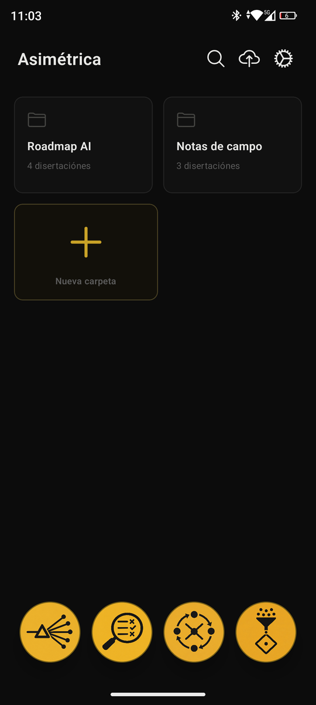
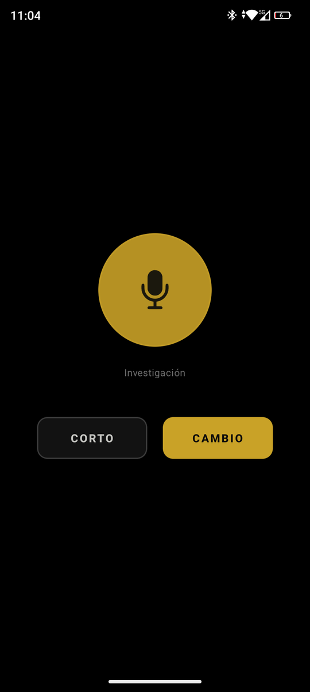
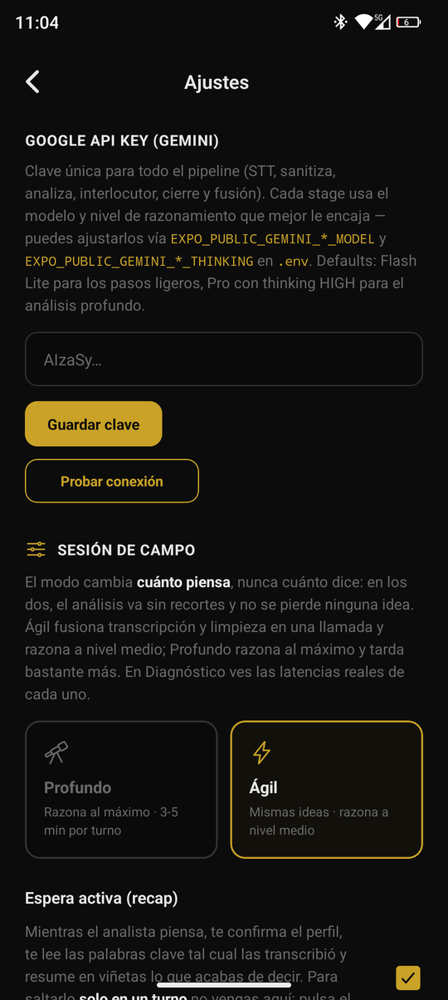
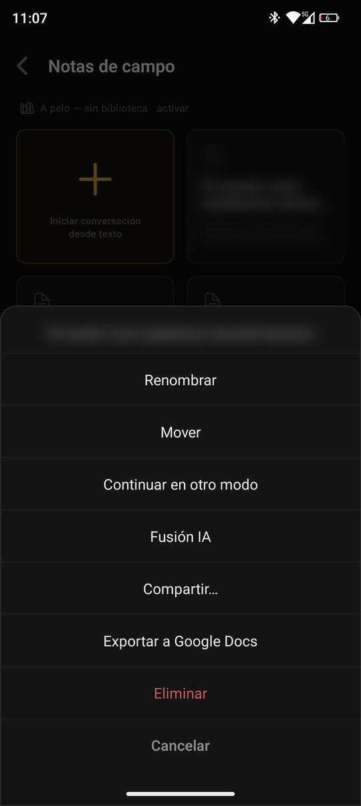

# Asimétrica

*[Leer en español](README.es.md)*

> Voice assistants are being optimised for speed. Speed is at odds with rigorous intellectual work, which is where the value is. If silence doesn't scare you, create without looking at a single screen.

Asimétrica is an Android app for thinking out loud on a walk. You talk into a wired headset; a strong model analyses what you said, takes its time, and answers in your ear. Everything ends up organised in folders, ready to share. **The phone never leaves your pocket.**

The asymmetry is the design: you speak for three minutes, the app thinks for one, and it answers with one considered position rather than a quick reply. The rest of the app exists to make that minute bearable and to make sure nothing said on the street is lost.

Expo / React Native, TypeScript, Gemini API. Bring your own key.

<p>




</p>

## Zero UI

- **The headset button runs the session.** One press is *Cambio*: your turn is over, send it. A double press is *Corto*: the session ends with a short closing note from the profile, not a summary.
- **Sound is the only status channel.** Four radio-style cues (mic open, received, success, error) and haptics. The session screen is black with one pulsing circle; the phases look the same on purpose.
- **Active waiting.** While the analyst thinks, a fast model reads back what it heard: the literal anchors from the transcript (names, figures, terms) and your ideas in short points. It confirms the transcription was right and re-anchors you after three minutes of talking. The anchors are extracted, never paraphrased, so a misheard name cannot sound right.
- **A continuous sound bed.** The music never stops during a session; it only ramps its volume (silent while you speak, low under the voice, higher while waiting). Synthesis gaps become musical pauses instead of looking like a crash.

## Four profiles: register, not task

Each profile sets a mood and an appetite for risk instead of a task. Any model will do any task when asked; what is worth separating is the stance.

| Profile | Stance |
|---|---|
| **Siembra** (sow) | In a very good mood, at the moment of opening. Doesn't judge; prefers saying something that might be wrong to staying silent. Never praises you |
| **Poda** (prune) | Taciturn, at the moment of closing. Goes slowly, says plainly what doesn't hold. Hard on the idea, correct with the person. Taciturn rather than angry, because anger makes a critic careless |
| **Custom** | Empty on purpose: you write your own in Settings |
| **Investigación** (research) | No register; a capability. It answers with Google Search, and can escalate to Gemini's Deep Research agent, which takes minutes and costs about $1–3, so the escalation is read back before any money is spent |

Names, icons and prompts can all be edited.

## Library of work: thinking against your own canon

Upload your novel, your outline or your style rules and assign them to folders. In those folders they become binding canon for the analyst.

- **Small documents go in whole.** A style sheet cannot depend on retrieval bringing it back.
- **Large ones are embedded** and the top passages retrieved for each turn. The query includes your previous turn, because "and how does that fit with before?" has nothing to search for on its own.
- **A relative threshold, not an absolute one.** Tested with real embeddings, an absolute similarity cut of 0.5 let everything through (6 of 6 passages for an unrelated question), so a turn about the plumber would have pulled random pages of the novel in as "relevant canon". The cut is now relative to the median, and an unrelated turn gets no library at all.
- **PDFs** are read with Gemini multimodal; only the text travels. Ingestion is resumable: if the app dies mid-way, it continues from the last finished phase without paying for embeddings twice.

## Nothing lost on the street

- **Pending tray.** If the pipeline fails mid-walk, the audio is moved to persistent storage and reprocessed later against the conversation as it is now. The `.m4a` is deleted only once the turn is saved.
- **Session recovery.** If the app dies mid-conversation, it offers to resume it.
- **Emergency voice.** If cloud speech fails, the phone's own voice reads the turn instead of breaking the walk.

## The pipeline, one model per stage

| Stage | Default model | Why |
|---|---|---|
| Speech to text | Flash Lite | Literal transcription. In *Ágil* mode it also cleans the text in the same call |
| Sanitise (*Profundo* only) | Flash Lite | Remove filler without changing meaning or answering |
| Read-back | Flash Lite | Runs in parallel; feeds nobody |
| Analyse | Pro, thinking high (*Ágil*: medium) | The core. Its output is internal and never spoken |
| Interlocutor | Flash, streamed | Turns the analysis into speech: prose only, structure carried in the words |
| Text to speech | Flash TTS, in chunks | See below |

The two modes differ in one thing only: how much the analyst thinks. Same ideas, same length.

**Speech in growing chunks.** Gemini TTS synthesises at about 0.6–0.9× real time. Sent whole, a long answer left 17 s of dead silence in the middle (up to 100 s in the deep mode). Now the first chunk is short, later ones grow, three are requested in parallel and each cut falls at the end of a sentence. While one chunk plays, more audio is generated than it lasts. The figures are in the comments of `services/ttsPlaybackService.ts`.

Every stage's model and thinking level can be changed with an `EXPO_PUBLIC_GEMINI_*` variable (`services/geminiModels.ts`).

## Why not CrewAI

Before settling on direct calls I measured the alternative. The same task, the same local model (`qwen2.5:7b`, temperature 0) and the same measuring proxy were used for both: audit 10 client requirements against a made-up technical spec, with a verdict, a literal quote and the section for each. There were 3 runs per variant.

| | CrewAI Flow (template pattern) | Own calls (5 steps, 1 model call) |
|---|---|---|
| Correct | **6 / 10** | **9 / 10** |
| Chat-model calls | 96 (+48 embedding calls) | 10 |
| Input / output tokens | 80,530 / 7,907 | 7,071 / 1,160 |
| Wall time per run | 431 s | 53 s |
| Quotes literally in the spec | 3 of 4 | 8 of 8 |

The three runs of each variant gave the same verdicts.

**Where each failed:**
- **CrewAI's four misses were all "open", never a wrong "complies" or "does not comply".** For a reviewer that is the safer failure. It also caught the subtlest trap (storage vs operating temperature). Most of its 96 calls came from the retry loop: the orchestrator read `approved` as "the requirement passes", so every non-compliant requirement was retried to the limit, and the retries did not change a single answer.
- **The own-calls version made one confident mistake.** The spec says 100–240 V and it answered "does not comply" for 230 V, with a correct, verified quote. Checking the quote proves the evidence exists, not that the reasoning about it is right.

**Why it is not the last word:**
- The spec is synthetic, with clean headings, which favours keyword retrieval (BM25) over embeddings.
- There was one task, one 7B model and 3 runs. A larger model would narrow the accuracy gap; the gap in calls and tokens is structural.
- Renaming `approved` would probably cut CrewAI to about 40 calls, but not raise its 6/10. That was not tested.

Code, data, raw logs and the full write-up (in Spanish), including what was done to keep CrewAI from being a straw man: [`experimentos/crewai-vs-llamadas/`](experimentos/crewai-vs-llamadas/README.md).

## Install it on your phone

The app is not on Google Play; it is installed from an APK file. You need Android 7.0 or later and about five minutes.

1. **Download the APK.** On the phone, open the [latest release](https://github.com/epifaneia/asimetrica/releases/latest) and tap `asimetrica-<version>.apk`. If the browser warns that the file may be harmful, choose *Download anyway*.
2. **Open the file.** Tap the download notification, or open *Files → Downloads* and tap the APK.
3. **Allow the install.** The first time, Android says the browser is not allowed to install apps. Tap *Settings*, turn on *Allow from this source*, go back and tap *Install*.
4. **If Play Protect asks**, tap *More details → Install anyway*. It asks because the app does not come from the Play Store, not because it found anything.
5. **Get a Gemini key.** Open [Google AI Studio](https://aistudio.google.com/apikey), sign in with a Google account and tap *Create API key*. Check your plan's limits there: the analysis stage uses a Pro model.
6. **Paste the key.** Open Asimétrica, go to *Ajustes* and paste it in the Google key field. It stays on the phone.
7. **Talk.** Allow the microphone the first time, then tap one of the four profiles on the home screen. A wired headset with a button gives you *Cambio* and *Corto* without touching the phone.

To update, install the new APK over the old one: your folders and settings are kept. To remove it, uninstall it like any other app; that also deletes everything it stored.

## Run it from the code

```bash
npm install
npx expo run:android      # dev build; the headset button needs it (Expo Go has no native key events)
```

Put the Gemini key in **Ajustes** inside the app, or in a local `.env` as `EXPO_PUBLIC_GOOGLE_API_KEY` for development. The published APK is built with `EXPO_NO_DOTENV=1`, so no `.env` value can end up inside it, and the bundle is checked for API keys before uploading.

The four cue sounds are generated with `python scripts/generar_avisos.py`. Audio credits: [CREDITS.md](CREDITS.md).

## Privacy and limits

- **Audio, text and library documents go to Google** (Gemini API): the audio on every turn, library text when it is indexed and the passages used in each analysis. Folders, conversations, the library and settings live on the phone.
- **The key is stored in plain AsyncStorage**, not in the Android Keystore.
- **Never build an APK to share with a key in `.env`.** Expo inlines `EXPO_PUBLIC_*` variables into the JavaScript bundle, so anyone with the APK can read them.
- **Deep Research costs real money** (about $1–3 per run). It is never the default and is read back before it starts.
- **The audio path cannot be tested from a desk.** Every change to sound is checked on a walk.
- **The cable button and much of the Zero-UI are Android-only.**
- There is no automated test suite in the repository; `npx tsc --noEmit` passes.
- The interface, the profiles and the prompts are in Spanish; the analyst answers in the language you speak.
